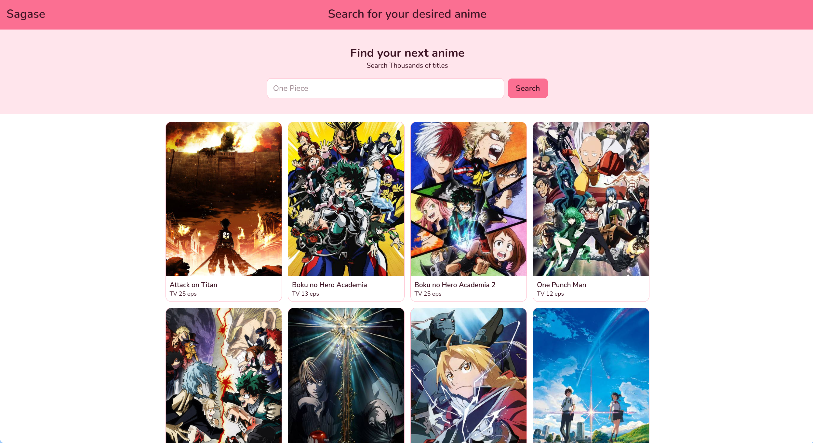
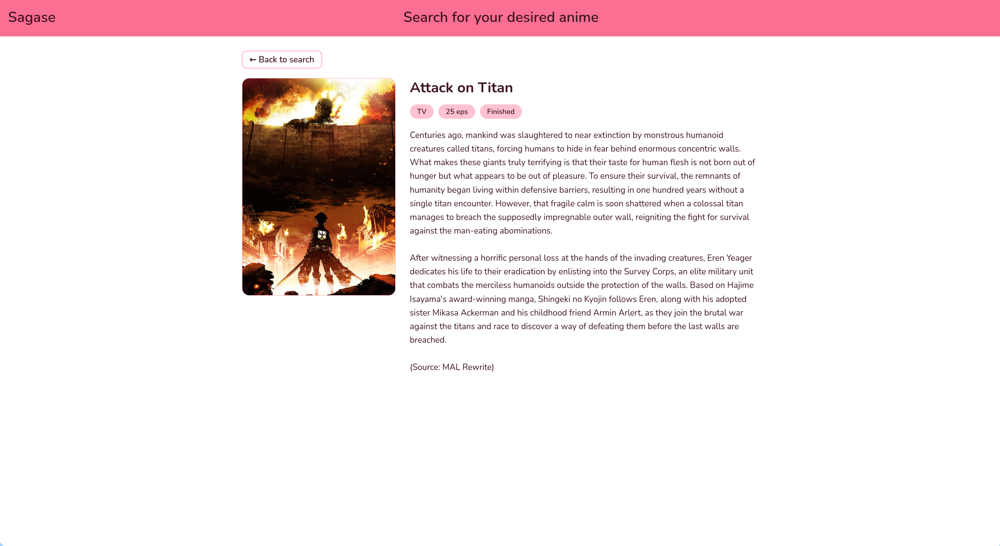

# Sagase

A small anime search app built with React. Search for any anime, browse the results as cards and open a details page for more info.

## Features

- Search anime by title
- Responsive grid of results (2 columns on mobile and 4 on desktop)
- Details page with poster, type, episode count, status and synopsis
- Loading and error messages
- Fallback for anime with missing posters or episode counts
- Stale request protection so old search results never overwrite new ones

## Tech stack

- React
- React Router
- Tailwind CSS
- Vite
- Kitsu API (free and no API key needed)
- Nunito font from Google Fonts
